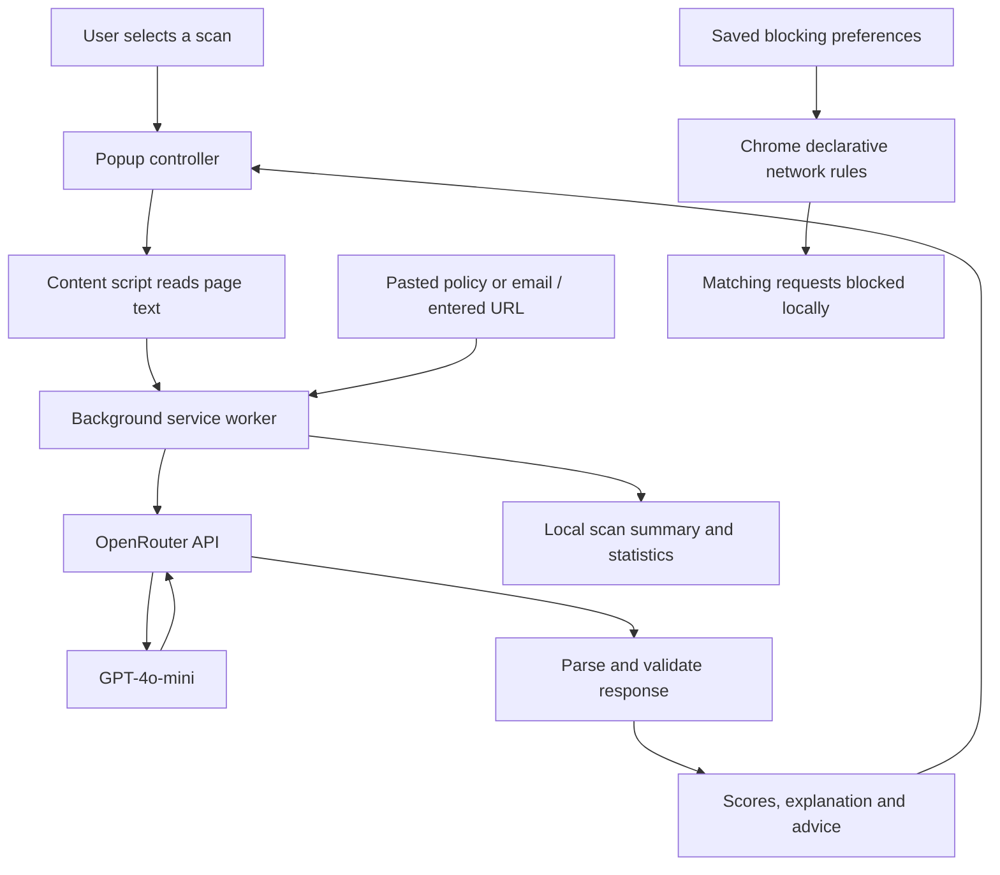

<div align="center">

# 🛡️ Guardian AI ANGEL

### A browser companion for clearer security and privacy decisions

**Check webpages · Understand privacy policies · Review payment risks · Spot suspicious emails**


Built by **[Harsh Mahadik](https://github.com/Harsh-mahadik999)**

[Getting started](#-getting-started) · [Features](#-features) · [How it works](#-how-it-works) · [Troubleshooting](#-troubleshooting) · [Contributing](#-contributing)

</div>

---

## 📖 About the project

Guardian AI ANGEL is a Chrome extension that combines local browser protections with optional AI analysis. It helps users understand what a page is asking for, identify suspicious patterns, and decide what to do next.

The extension provides a single popup with **Dashboard, Scanner, Privacy, Payment, Email, and Settings** tabs. Local rules block listed advertising, tracking, and malware-related requests. When a user requests an AI scan, the extension sends a limited text excerpt to OpenRouter and presents the response as scores, explanations, warning signs, and suggested actions.

The current AI configuration uses **GPT-4o-mini through OpenRouter**. There is no application backend to deploy and no build step required to load the extension.

> **Project status:** This is a developing security assistant. AI assessments and local heuristics can be incomplete or incorrect. A “Safe” or “Legit” result is an assessment, not a guarantee, certification, antivirus scan, or proof of a website's identity.

## 🎯 Why Guardian AI exists

Everyday browsing can involve long privacy policies, unfamiliar checkout pages, misleading links, and convincing phishing messages. Users often need an explanation of the warning signs before deciding whether to continue.

Guardian AI aims to make those checks easier by bringing page analysis and privacy controls into the browser, with readable results instead of unexplained scores.

## ✨ Features

| Feature | What it does | Requires an API key? |
| --- | --- | --- |
| Website scanner | Reviews current-page text for security and privacy concerns; returns reasons and advice | Yes |
| Privacy policy analyzer | Summarizes a policy and identifies potentially risky clauses from a page or pasted text | Yes |
| Payment risk assessment | Reviews checkout-page text or a manually entered URL for fraud warning signs | Yes |
| Email analysis | Assesses pasted email content; supports optional Gmail integration | Yes |
| Ad blocking | Blocks requests matching the bundled ad rules | No |
| Tracker blocking | Blocks requests matching the bundled tracker rules | No |
| Malware-domain rules | Blocks requests matching the bundled malware rules | No |
| Cookie rejection | Attempts explicit reject-all or necessary-only actions on supported consent banners | No |
| Link highlighting | Outlines links matching local suspicious-link heuristics | No |
| Dashboard | Displays the current page's available AI assessment, latest scan, and activity statistics | AI results require a key |

### Website scanner

Use **Scanner → Scan this page** or **Dashboard → Check this page** to request an assessment of the current website.

The result includes:

- A safety score from **0 to 100**, where a higher value indicates a safer AI assessment.
- A category such as **Safe**, **Moderate Risk**, **High Risk**, or **Dangerous**.
- Potential threats and positive signals found in the provided content.
- A plain-language explanation and a suggested next step.

The scanner reads visible page text. It does not crawl every link, inspect downloaded files, execute suspicious code, or audit a site's server infrastructure.

### Privacy policy analyzer

Use **Privacy → Analyze Current Page Policy**, or paste policy text into the input field.

Results include a summary, key points, risk clauses, a privacy risk score, and a recommendation. Automatic policy analysis can be enabled separately in Settings. An AI recommendation does not accept a policy or grant consent on the user's behalf.

### Payment risk assessment

Use **Payment → Verify This Payment Page** for the active page, or enter a URL and choose **Verify URL**.

Results include an AI verdict, fraud risk score, warning flags, and an explanation. The HTTPS indicator is derived from the supplied URL. Domain age is shown as **Unknown**, because the extension does not perform a registration-age lookup.

**URL-only checks do not fetch or inspect the destination page.** They give the model the entered URL without checkout-page content.

### Email analysis

Paste an email's subject, sender, and body into the **Email** tab, then select **Analyze Email**. Results include a trust score, verdict, red flags, suspicious links identified by the model, and an explanation.

Optional automatic Gmail analysis watches for an opened message using Gmail's page structure. It is **off by default**. Sender reputation is an AI assessment, not an authenticated sender or reputation-service lookup.

### Local protection

Ad and tracker switches control Chrome's declarative network rules. A third bundled ruleset covers selected malware-related domains.

Cookie rejection searches for visible, enabled buttons with explicit English labels such as “Reject all” or “Necessary only” inside cookie/consent containers. It does not navigate complex preference dialogs or click an “Accept all” button. In permissive mode, cookie choice is left to the user.

Suspicious-link highlighting uses URL and text heuristics. Highlighting is a warning cue; it does not block the link or establish that it is malicious.

## 🚀 Getting started

### Requirements

- Google Chrome with extension Developer mode available.
- The project files on your computer.
- An OpenRouter API key and internet access for AI features.
- Available OpenRouter credits and sufficient key spending allowance for the configured model.
- **Node.js 20 or newer only if you want to run the automated tests.**

### 1. Download the repository

Clone it with Git:

```sh
git clone https://github.com/Harsh-mahadik999/AI-guardian-ANGEL---GOOGLE-EXTENSION--.git
cd AI-guardian-ANGEL---GOOGLE-EXTENSION--
```

Alternatively, use GitHub's **Code → Download ZIP**, then extract the archive before loading it.

### 2. Load the extension in Chrome

1. Enter `chrome://extensions` in Chrome's address bar.
2. Turn on **Developer mode**.
3. Select **Load unpacked**.
4. Choose the **google extension** subfolder, which contains `manifest.json`.
5. Pin **Guardian AI Shield** from Chrome's Extensions menu.

```text
Repository folder/
└── google extension/     ← Select this folder in Load unpacked
    ├── manifest.json
    ├── background.js
    ├── content.js
    └── popup.html
```

> Do not select the repository root, a ZIP archive, or an empty folder. Chrome needs `manifest.json` directly inside the selected directory. If you copied the extension into another folder, select that folder only when the manifest and its companion files are present.

There is no bundler, build command, or dependency installation required for loading this version.

### 3. Connect AI once

1. Obtain a key from [OpenRouter](https://openrouter.ai/keys).
2. Open Guardian AI and paste the key into the setup field.
3. Select **Activate Guardian AI**.
4. Confirm the dashboard shows **Active (OpenRouter)**.

The key is saved in **Chrome's local extension storage** and reused when the popup is reopened. Sharing a key in a chat or editing project documentation does not save it in the extension.

A different Chrome profile, a separately loaded copy of the extension, removing/reinstalling it, or clearing its data can require setup again. Keep using the same loaded folder and reload it when updating files.

You can choose **Continue without AI features** to use the local protections. This does not activate AI scanning.

### 4. Run your first scan

1. Open a regular public webpage.
2. Refresh the tab after installing or reloading the extension.
3. Open Guardian AI and select **Scanner → Scan this page**.
4. Read the assessment, warning signs, and recommended action.

If a tab has no content script, the popup attempts to inject it and retry the request. Browser-restricted pages still cannot be scanned.

## ⚙️ Settings

| Setting | Default | Behavior |
| --- | --- | --- |
| Ad Blocker | On | Enables/disables the bundled ad rules |
| Tracker Shield | On | Enables/disables the bundled tracker rules |
| Auto Consent Reject | On | Attempts supported explicit cookie-rejection actions |
| Auto-Consent Mode | Strict | Strict and moderate currently use the same conservative reject/necessary-only matching; permissive leaves choice manual |
| Payment Verification | Off | Opts into automatic AI analysis on detected payment pages |
| Auto Privacy Analysis | Off | Opts into automatic AI analysis on detected policy pages |
| Automatic Email Scan | Off | Opts into sending opened Gmail message text for analysis |
| Suspicious Link Highlight | On | Enables automatic heuristic link highlighting |

Ad and tracker changes are applied to the blocking rules immediately. **Refresh existing pages after changing content-script settings**, especially when enabling an automatic scan feature or changing link highlighting.

**Clear API Key & Reset** removes the saved key, resets preferences and statistics, and removes the saved latest scan. It does not revoke the key at OpenRouter.

The active popup also includes a theme toggle. Theme selection is currently a popup-session preference rather than a persistent setting.

## 🧠 How it works



### Main components

| Component | Responsibility |
| --- | --- |
| `manifest.json` | Manifest V3 configuration, permissions, popup, service worker, content scripts, and static rulesets |
| `background.js` | Routes extension messages, calls OpenRouter, validates responses, stores statistics, and synchronizes blocking preferences |
| `content.js` | Reads page text, detects supported page categories, handles supported consent banners, highlights links, and displays inline results |
| `popup.html` / `popup.js` | Dashboard, scan controls, results, one-time key setup, and settings |
| `utils/languageDetector.js` | Lightweight script-based heuristic for English, Hindi, Bengali, and Tamil |
| `rules/*.json` | Static ad, tracker, and malware request-blocking rules |

The language helper is a heuristic, not a full multilingual classifier. For example, Devanagari text is treated as Hindi even though other languages use that script.

### AI configuration

```js
const API_ENDPOINT = 'https://openrouter.ai/api/v1/chat/completions';
const MODEL = 'openai/gpt-4o-mini';
```

Requests use bearer authentication, JSON response mode, separate system and user messages, and a 25-second request timeout. The parser checks required fields, validates list types, bounds numeric scores, and uses a fallback result for malformed analysis output. API failures are reported to the user, including missing credentials, insufficient credits, and rate limits.

Configuration is in `google extension/background.js`. Model availability and costs depend on the provider; see the [configured model's page](https://openrouter.ai/openai/gpt-4o-mini) and [OpenRouter API documentation](https://openrouter.ai/docs/api/reference/overview).

### Understanding scores

| Result | Meaning of a higher score |
| --- | --- |
| Website safety score | Safer assessment |
| Email trust score | More trustworthy assessment |
| Privacy risk score | Greater privacy risk |
| Payment fraud risk score | Greater suspected fraud risk |

Scores are model-generated assessments, not measured probabilities. The dashboard shows **Ready to check** when there is no suitable saved assessment for the active URL.

## 🔐 Privacy and data handling

### What leaves the browser?

Local blocking, cookie matching, and link highlighting do not need AI requests. AI scans send the relevant URL/title or email metadata, plus a limited text excerpt, to **OpenRouter and its selected model provider**.

| Analysis | Main text excerpt limit in the AI prompt |
| --- | --- |
| General website scan | First 3,000 characters of page text |
| Privacy policy | First 4,000 characters of policy text |
| Payment page | First 2,000 characters of page text |
| Email | First 2,000 characters of body text |

These are text-excerpt limits, not total request-size limits: instructions, URLs, titles, subjects, and sender fields are additional content. The extension does not perform comprehensive personal-data redaction before sending an excerpt. Do not scan content you do not want to share with the AI providers.

Automatic privacy, payment, and Gmail analysis require opt-in. General category-based automation also skips some sensitive hostnames and URL patterns; this filter does not identify every sensitive page. Manual scans send the selected content when requested. An automatic category scan may make both a specialized analysis request and a general page-analysis request.

### What is stored?

- **Local extension storage:** API key, activity statistics, and the most recent stored page-scan summary.
- **Chrome sync storage:** protection and automation preferences, which may sync when Chrome sync is enabled.
- **Git repository:** source code and tests. Credentials must not be included.

The application does not have its own remote data-storage backend. That does not mean AI requests are entirely local or that third-party providers never retain data. Their policies apply to the requests they receive. Chrome local storage is not a dedicated encrypted credential vault.

**Credential history:** An older revision contained a hardcoded Google API credential. The working implementation no longer includes it, but removing a value from source does not remove it from Git history or revoke it. The original credential should be revoked at its issuing provider. Never publish real keys in source, screenshots, issues, or pull requests.

## 🔑 Extension permissions

The current manifest requests the following permissions:

| Permission | Current purpose or status |
| --- | --- |
| `storage` | Saves configuration, credentials, preferences, and scan activity |
| `declarativeNetRequest` / `declarativeNetRequestWithHostAccess` | Supports the static request-blocking rules |
| `scripting` | Reconnects to supported existing tabs by injecting the content script |
| `tabs` / `activeTab` | Identifies the active tab and supports page actions |
| `alarms` | Schedules weekly chart-data resets |
| `notifications` / `webNavigation` | Supports the background navigation-warning path; this is not comprehensive threat detection |
| `cookies` | Currently declared, but the implemented consent handler clicks page controls rather than editing cookies through the Cookies API |
| `<all_urls>` host access | Allows page integration and blocking across supported websites, plus the AI API request |

The manifest is broad. Reviewing and reducing redundant or unused permissions is part of the roadmap. Browser-internal pages and other restricted surfaces remain inaccessible despite host permissions.

## 📂 Repository structure

```text
AI-guardian-ANGEL---GOOGLE-EXTENSION--/
├── .github/                         # Repository workflows
├── .gitignore
├── README.md
├── CONTRIBUTING.md
├── SECURITY.md
├── LICENSE.md
├── package.json                     # Node test command; no runtime dependencies
├── tests/
│   └── extension.test.js            # Automated regression tests
├── original-browser-metadata/       # Preserved generated metadata, outside loadable folder
└── google extension/                # Load this folder in Chrome
    ├── manifest.json
    ├── background.js
    ├── content.js
    ├── content.css
    ├── popup.html                   # Active popup
    ├── popup.js
    ├── icons/
    ├── rules/
    │   ├── ads.json
    │   ├── trackers.json
    │   └── malware.json
    ├── utils/
    │   ├── languageDetector.js      # Browser-ready module
    │   └── languageDetector.ts      # Retained original TypeScript source
    ├── popup_simple.html            # Legacy alternative; not the active popup
    ├── popup_simple.js
    ├── styles.css
    ├── rules.json                   # Legacy file; not the configured ruleset paths
    ├── make_icons.js
    ├── make_icons.ps1
    ├── make_icons.py
    ├── FEATURES_INSTALLED.md         # Earlier project notes
    └── HACKATHON_DEMO_README.md      # Earlier demo notes
```

The manifest determines which files are active. Earlier feature/demo notes and the legacy popup may describe behavior that differs from the current implementation. Chrome-generated `_metadata` should not be copied into the loadable source folder; Chrome manages generated data itself.

## 🧪 Development and testing

### Run automated checks

From the repository root, with Node.js 20+ installed:

```sh
npm test
```

On Windows PowerShell, if execution policy blocks `npm.ps1`, use:

```powershell
npm.cmd test
```

The suite currently contains **17 tests** covering:

- JavaScript syntax, manifest resources, and ruleset ID uniqueness.
- Browser-ready language detection.
- Key save, validation, suffix display, and removal.
- Missing-key handling without sending page content.
- OpenRouter endpoint, authorization, model, and JSON-mode configuration.
- Billing and rate-limit error reporting.
- Preservation of zero scores and malformed-output fallbacks.
- Concurrent statistics updates and blocking preference changes.
- Automatic-scan opt-in and pause behavior.
- HTTPS labeling and unknown domain age.
- Conservative cookie actions and escaped AI text in the popup.
- Navigation panels, scan buttons, and reconnection to existing tabs.

Tests use mocked Chrome APIs and mocked AI responses. A passing suite is not a substitute for testing the loaded extension in Chrome or a guarantee of provider availability.

### Manual smoke test

1. Load or reload the extension and refresh a public, non-sensitive page.
2. Open the popup and confirm it displays at its intended width.
3. Save a valid key, close the popup, and reopen it to check persistence.
4. Run a page scan and confirm a result, explanation, and advice appear.
5. Try a pasted policy and a synthetic phishing email.
6. Test a payment URL and confirm the interface labels HTTPS without claiming a certificate audit.
7. Toggle ad/tracker blocking and check the enabled rulesets or matching requests in Chrome developer tools.
8. Verify automatic AI settings are off until deliberately enabled.
9. Inspect the extension's **Errors** and service-worker console from `chrome://extensions` when diagnosing a failure. Redact sensitive information before sharing logs.

**Validation boundary:** The local automated suite passed during refinement. A separate authenticated OpenRouter request returned a valid analysis, and Chrome key setup was verified. A complete browser scan across all feature tabs has not yet been verified; do not treat those earlier checks as full end-to-end certification.

## 🛠️ Troubleshooting

| Problem | What to check |
| --- | --- |
| “Manifest file is missing or unreadable” | Select `google extension`, or the copied folder containing `manifest.json` directly. Extract ZIP files first. |
| “No API key found” | Save the key through this installation's setup screen or Settings. A key in chat is not automatically in Chrome storage. |
| Setup appears again | Check that you are using the same Chrome profile and extension installation, and that storage was not cleared. |
| “Invalid API key” | Use an OpenRouter key beginning with `sk-or-v1-`; a Gemini key cannot authenticate to the configured endpoint. |
| Insufficient credits | Check the OpenRouter balance and the key's spending limit. |
| Rate limit reached | Wait before retrying and review the provider's request limits. |
| Page cannot be read / no receiving end | Refresh the website and try again. The popup also attempts automatic content-script reconnection. |
| Scan fails on a browser settings/store page | Switch to a normal `https://` website. Chrome restricts extension access to these pages. |
| Changes are not visible | Save the files, reload the same extension at `chrome://extensions`, then reopen the popup and refresh the webpage. |
| Cookie banner remains | The banner may use unsupported labels, an iframe, a shadow root, or a preference flow the handler does not support. |
| Blocking counters stay at zero | Network rule-match counting is not wired into these counters in this version. Zero is not evidence that nothing was blocked. |
| AI response is incomplete | Only a text excerpt is sent. Try a more relevant excerpt or page; results may fall back if the response fails validation. |
| Automatic Gmail scan does not appear | Enable Automatic Email Scan, refresh Gmail, and open a message. Gmail markup changes may affect detection. |

## ⚠️ Current limitations

- Static blocking lists cover only their included patterns and are not a continuously updated reputation feed.
- Ad, tracker, and malware counters are not connected to actual network rule matches. The visible coverage indicators should not be interpreted as measured protection percentages.
- Page, threat, and consent statistics represent application events and heuristic/model findings. They are not independently verified incidents or a complete browsing audit.
- Scan results can become stale when page content changes without a new scan. Only the most recent page-scan summary is stored.
- No certificate-chain audit, domain-age service, malware-file analysis, or authenticated sender verification is implemented.
- The AI sees limited text, not the full page's behavior or all embedded resources.
- Consent detection, language detection, Gmail integration, and suspicious-link matching are heuristic and have coverage gaps.
- Provider downtime, balance limits, response delays, or model changes can prevent AI features from working.
- A private local development installation does not constitute Chrome Web Store approval or a completed security audit.

## 🗺️ Roadmap

The following are planned improvements, not currently completed features:

- [ ] Complete browser integration tests for every scan type.
- [ ] Add reliable network-blocking statistics and accurate coverage indicators.
- [ ] Reduce unused/redundant permissions.
- [ ] Improve consent-banner coverage and dynamic page handling.
- [ ] Add configurable models and connection diagnostics.
- [ ] Improve multilingual detection and explanations.
- [ ] Add optional redaction before transmitting page or email excerpts.
- [ ] Integrate independently sourced domain reputation and registration-age checks.
- [ ] Improve accessibility and preserve appearance preferences.
- [ ] Prepare a documented release and Chrome Web Store review package.

## 🤝 Contributing

Contributions to bug fixes, tests, accessibility, privacy handling, and documentation are welcome.

1. Fork the repository and create a focused feature/fix branch.
2. Make your changes in the active files under `google extension/`.
3. Run `npm test` and manually verify the affected behavior in Chrome.
4. Submit a pull request explaining the problem, the change, and validation performed.

Read [CONTRIBUTING.md](CONTRIBUTING.md) and [SECURITY.md](SECURITY.md). For installation, follow this README's explicit `google extension` folder selection. Never include credentials or private browsing content in contributions.

Report reproducible bugs through the [issue tracker](https://github.com/Harsh-mahadik999/AI-guardian-ANGEL---GOOGLE-EXTENSION--/issues), including expected behavior, actual behavior, Chrome version, and a redacted error or screenshot.

## 📄 License

Distributed under the **MIT License**. See [LICENSE.md](LICENSE.md) for the full terms.

## 👤 Author
neha

If the project helps you, consider starring the repository or contributing a reproducible bug report.
